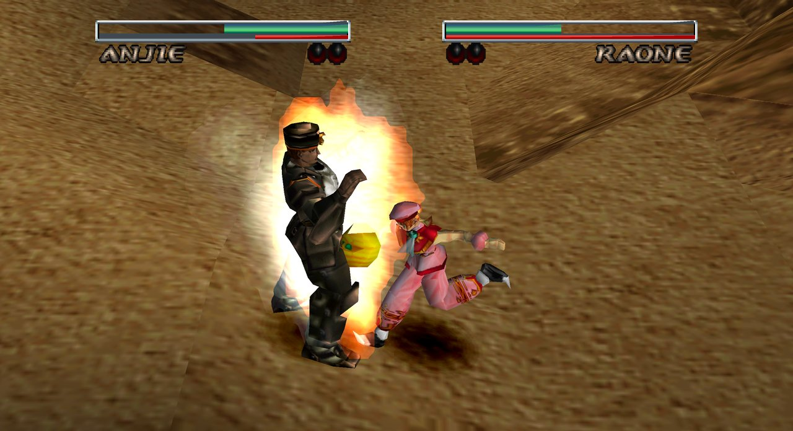
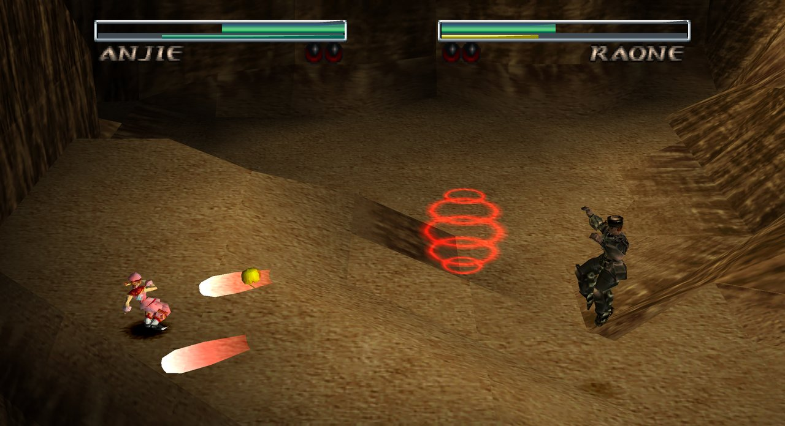
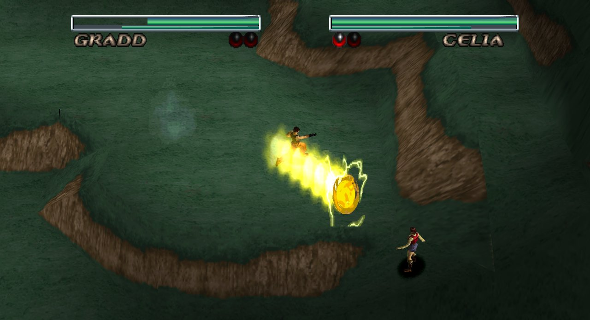
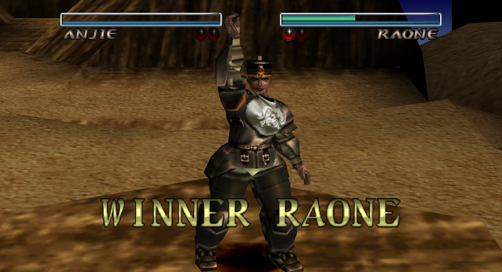

# Destrega Redux: an enhanced online native port

The PlayStation fighting game *Destrega* (Koei, 1998), with frame-for-frame identical gameplay, better graphics, widescreen, and online rollback netplay, for Windows/Mac/Linux.

- **Better graphics**: high-resolution rendering (up to 4x6 the original resolution, with
  automatic scaling to what your computer can keep up with), a GPU renderer on Metal, Vulkan and
  Direct3D 12, 16:9 widescreen fights, sub-pixel vertices and perspective-correct textures (no
  wobble or warping), smoothed 2D and 3D textures, full-precision colour and anti-aliasing. All of
  it is presentation only: the game itself sees exactly what a PS1 would.
- **Rollback netplay**: online two-player matches with GGPO-style rollback (Netplay > Host Game /
  Join Game), automatic router port opening, desync detection, and Mac <-> Windows play.
- **A desktop app**: native menus, full screen, rebindable keyboard and controller controls,
  save-game import / export, settings that persist.

Built from Rogers de Cristo's [Destrega Recomp](https://github.com/rogerscristo/destrega-recomp).

| | |
|---|---|
|  |  |
|  |  |

*Captured from this port: GPU renderer at 4x6 the original resolution, 16:9 widescreen,
smoothed textures and full-precision colour.*


You need your own copy of the game: the North American release (SLUS-00732)
as a MODE2/2352 `.cue`/`.bin`. Nothing from the game is in this repository.

## Requirements (all platforms)

- CMake 3.20+ and Ninja (or another CMake generator)
- A C11 compiler: **Clang or GCC** (MSVC's `cl` is not supported; on Windows use MinGW/MSYS2 or `clang-cl`)
- Python 3 (runs the recompiler during the build)
- SDL3 and zlib development packages

## Build

The build turns the game's executable into C, so it needs the extracted disc
files in `disc/` once:

```sh
python3 tools/extract_disc.py /path/to/Destrega.bin disc
cmake -S . -B build/cmake -G Ninja
cmake --build build/cmake
```

### macOS

```sh
brew install sdl3 cmake ninja python
```

Then run the build steps above. On macOS the build also produces
`build/cmake/Destrega.app`: a self-contained app (SDL3 bundled, with an icon)
that you can drag to `/Applications` and launch from Finder. The plain
`./build/cmake/destrega` binary is still there for the command-line options.

The app is ad-hoc signed, which is enough to run it on the Mac that built it.
To give it to someone else without Gatekeeper warnings, sign it with a
Developer ID and notarize it:

```sh
cmake -S . -B build/cmake -DDESTREGA_APP_SIGN="Developer ID Application: Your Name (TEAMID)"
cmake --build build/cmake
tools/make_app.sh --help    # bundling options, including --dmg
```

Turn the bundle off with `-DDESTREGA_MACOS_APP=OFF`. The icon
(`assets/icon/destrega.png`) is original artwork drawn by `tools/make_icon.py`;
it uses no game assets.

### Linux

Install the dependencies for your distribution:

```sh
# Ubuntu 25.04+ / Debian 13+
sudo apt install build-essential cmake ninja-build python3 libsdl3-dev zlib1g-dev
# Fedora 42+
sudo dnf install gcc cmake ninja-build python3 SDL3-devel zlib-devel
# Arch
sudo pacman -S base-devel cmake ninja python sdl3 zlib
```

If your distribution doesn't package SDL3 yet, build it from
[source](https://github.com/libsdl-org/SDL) and point CMake at it with
`-DCMAKE_PREFIX_PATH=/path/to/sdl3/install`.

Then run the build steps above and start the game with `./build/cmake/destrega`.

### Windows

Use [MSYS2](https://www.msys2.org/) and its **UCRT64** shell:

```sh
pacman -S mingw-w64-ucrt-x86_64-gcc mingw-w64-ucrt-x86_64-cmake mingw-w64-ucrt-x86_64-ninja \
          mingw-w64-ucrt-x86_64-python mingw-w64-ucrt-x86_64-sdl3 mingw-w64-ucrt-x86_64-zlib
```

Then run the build steps above (from the UCRT64 shell) and start the game with
`./build/cmake/destrega.exe`. To launch it outside the MSYS2 shell, copy
`SDL3.dll`, `zlib1.dll` and the GCC runtime DLLs from `C:\msys64\ucrt64\bin`
next to `destrega.exe`.

## Downloads, packaging and releases

The [releases page](https://github.com/marinohardin/destrega-redux/releases) has **alpha** test
builds of the launcher for macOS, Windows and Linux: they contain no game code or data, and turn
your own disc into the game on first launch (see `docs/RELEASE_NOTES_0.1.0-alpha.md`). They are not
user-friendly yet. A build made from your disc with the steps above holds translated game code and
cannot be redistributed: `tools/package_release.sh mac|win --personal` zips it for your own
machines only. See `docs/RELEASES.md` for the details and the macOS notarization steps.
Third-party licences: `THIRD_PARTY_LICENSES.txt`.

## First launch

The game asks for your disc image (`.cue` or `.bin`), checks it is the
supported version, and converts it once into a private data pack (~330 MB).
After that it runs from the pack, and the original image can be deleted or
moved. The pack is stored in your per-user data folder:

| OS | Data pack location |
|---|---|
| macOS | `~/Library/Application Support/Destrega/destrega.pak` |
| Linux | `~/.local/share/Destrega/destrega.pak` |
| Windows | `%APPDATA%\Destrega\destrega.pak` |

Command-line import: `destrega --import /path/to/Destrega.cue`. A different
location can be chosen with `--data-dir DIR`. To recreate `disc/` later
without the original image, pass the pack to the extractor instead:
`python3 tools/extract_disc.py <data pack path> disc`.

## Controls

| Keyboard | PS1 button | In a fight |
|---|---|---|
| Arrow keys | D-pad | Move |
| A | Square | Quick attack |
| S | Triangle | Strong attack |
| X | Circle | Sidestep |
| Z | Cross | Jump / confirm in menus |
| Q / W | L1 / R1 | Guard / dash |
| E / R | L2 / R2 | |
| Enter | Start | Pause / confirm |
| Backspace | Select | |

Tab = fast-forward, F12 = screenshot, Esc = quit. Gamepads work (the second
pad is player 2). Step far back until the charge bar turns blue to use magic.

## Status

Version 0.1.0 (**alpha**). Boots, plays the intro FMV with audio, title, menus and every mode; fights,
story, practice and VS are playable (60 Hz output; fights update at 30 fps, as on the original).
Memory-card saves work. Rollback netplay works between Macs and between a Mac and Windows. The
native 3D renderer draws stages and fighters (`docs/HLR_PLAN.md`; shadows, effects, 60 Hz motion and
story scenes are in progress). Developed and tested on macOS (Apple Silicon); the Windows build is
tested under Wine/CrossOver and the Linux build in CI (without the game). See `AGENTS.md` for
internals and `tools/pr_check.sh` / `tools/run_tests.sh` for the tests.

<sub>Licensed under the GPL-3.0 (`LICENSE`). Game data and code stay with their owners and are never part of this repository.</sub>
