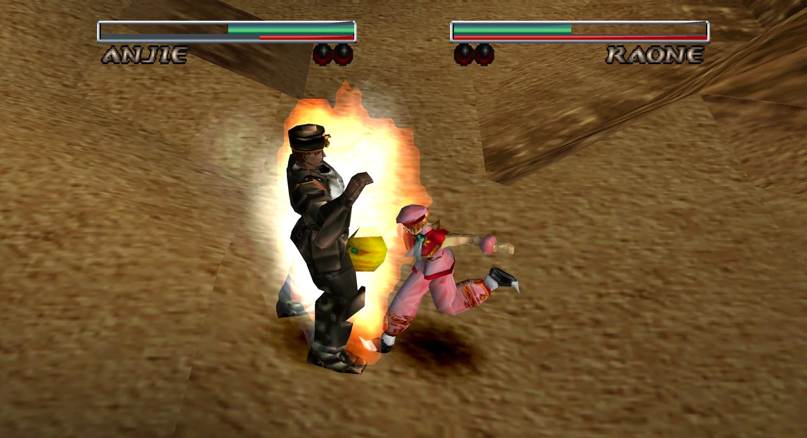
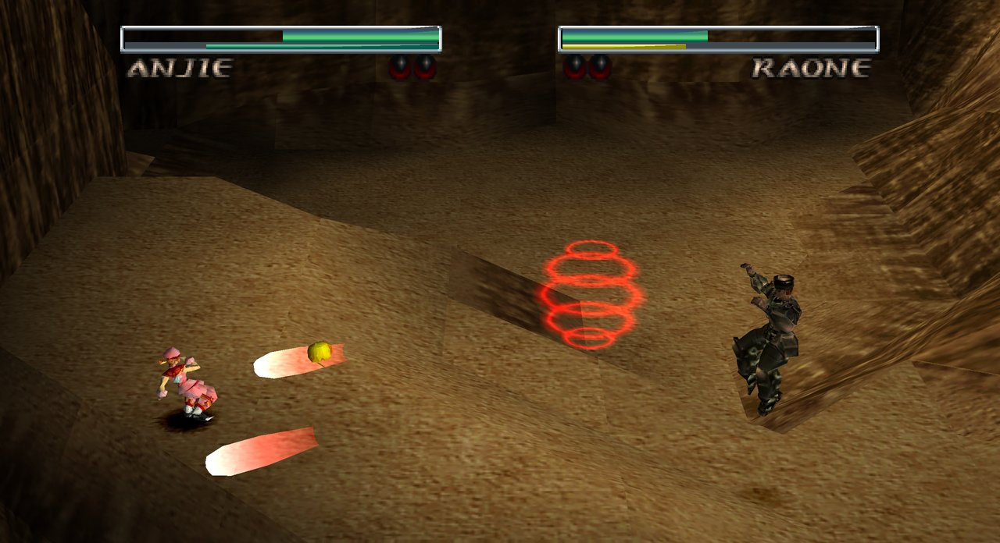
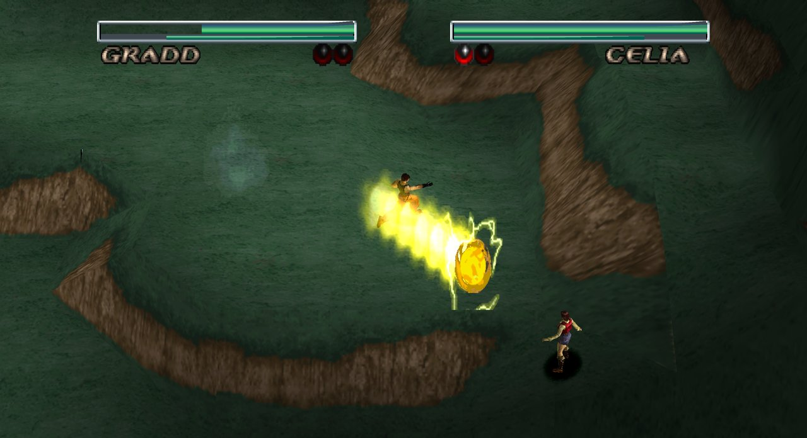
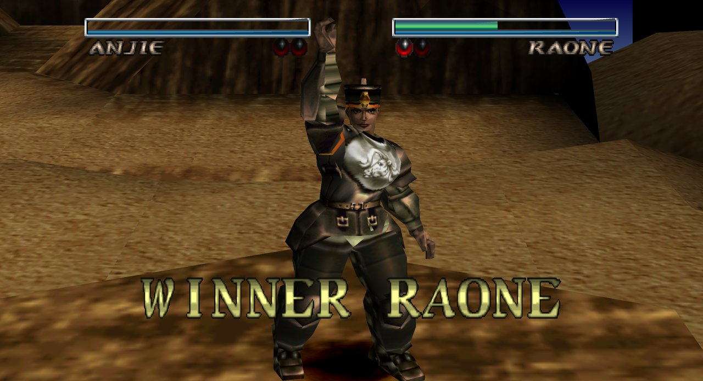

# Destrega Redux: an enhanced online native port

The PlayStation fighting game *Destrega* (Koei, 1998), with frame-for-frame identical gameplay, better graphics, widescreen, and online rollback netplay, for Windows/Mac/Linux.

> [!IMPORTANT]
> Destrega Redux is an unofficial, non-commercial fan project. It is not affiliated with,
> endorsed by or sponsored by Koei Tecmo or Sony Interactive Entertainment. All trademarks
> belong to their owners.
>
> No game data is included or distributed: no disc images, no textures, models, sound, music or
> films, and no memory-card saves. To play you need your own, legally obtained disc of the
> supported retail release for the PlayStation: North America (NTSC-U, SLUS-00732). Destrega Redux
> checks a copy of it and takes the game data from there. Please do not ask for game files or disc
> images, and do not share them. See the full [legal notice](#legal-notice).

- **Better graphics**: high-resolution rendering (up to 4x6 the original resolution, with
  automatic scaling to what your computer can keep up with), a GPU renderer on Metal, Vulkan and
  Direct3D 12, 16:9 widescreen fights, sub-pixel vertices and perspective-correct textures (no
  wobble or warping), smoothed 2D and 3D textures, full-precision colour and anti-aliasing. All of
  it is presentation only: the game itself sees exactly what a PS1 would.
- **Rollback netplay**: online two-player matches with GGPO-style rollback (Netplay > Host Game /
  Join Game), automatic router port opening, desync detection, and Mac <-> Windows play.
- **A desktop app**: native menus, full screen, rebindable keyboard and controller controls,
  save-game import / export, settings that persist.

Built from Rogers de Cristo's [Destrega Recomp](https://github.com/rogerscristo/destrega-recomp).

| | |
|---|---|
|  |  |
|  |  |

*Captured from this port: GPU renderer at 4x6 the original resolution, 16:9 widescreen,
smoothed textures and full-precision colour.*


You need your own copy of the game: the North American release (SLUS-00732)
as a MODE2/2352 `.cue`/`.bin`. No game data is in this repository or in the downloads.

## Requirements (all platforms)

- CMake 3.20+ and Ninja (or another CMake generator)
- A C11 compiler: **Clang or GCC** (MSVC's `cl` is not supported; on Windows use MinGW/MSYS2 or `clang-cl`)
- Python 3 (runs the recompiler during the build)
- SDL3 and zlib development packages

## Build

The build turns the game's executable into C, so it needs the extracted disc
files in `disc/` once:

```sh
python3 tools/extract_disc.py /path/to/Destrega.bin disc
cmake -S . -B build/cmake -G Ninja
cmake --build build/cmake
```

### macOS

```sh
brew install sdl3 cmake ninja python
```

Then run the build steps above. On macOS the build also produces
`build/cmake/Destrega.app`: a self-contained app (SDL3 bundled, with an icon)
that you can drag to `/Applications` and launch from Finder. The plain
`./build/cmake/destrega` binary is still there for the command-line options.

The app is ad-hoc signed, which is enough to run it on the Mac that built it.
To give it to someone else without Gatekeeper warnings, sign it with a
Developer ID and notarize it:

```sh
cmake -S . -B build/cmake -DDESTREGA_APP_SIGN="Developer ID Application: Your Name (TEAMID)"
cmake --build build/cmake
tools/make_app.sh --help    # bundling options, including --dmg
```

Turn the bundle off with `-DDESTREGA_MACOS_APP=OFF`. The icon
(`assets/icon/destrega.png`) is original artwork drawn by `tools/make_icon.py`;
it uses no game assets.

### Linux

Install the dependencies for your distribution:

```sh
# Ubuntu 25.04+ / Debian 13+
sudo apt install build-essential cmake ninja-build python3 libsdl3-dev zlib1g-dev
# Fedora 42+
sudo dnf install gcc cmake ninja-build python3 SDL3-devel zlib-devel
# Arch
sudo pacman -S base-devel cmake ninja python sdl3 zlib
```

If your distribution doesn't package SDL3 yet, build it from
[source](https://github.com/libsdl-org/SDL) and point CMake at it with
`-DCMAKE_PREFIX_PATH=/path/to/sdl3/install`.

Then run the build steps above and start the game with `./build/cmake/destrega`.

### Windows

Use [MSYS2](https://www.msys2.org/) and its **UCRT64** shell:

```sh
pacman -S mingw-w64-ucrt-x86_64-gcc mingw-w64-ucrt-x86_64-cmake mingw-w64-ucrt-x86_64-ninja \
          mingw-w64-ucrt-x86_64-python mingw-w64-ucrt-x86_64-sdl3 mingw-w64-ucrt-x86_64-zlib
```

Then run the build steps above (from the UCRT64 shell) and start the game with
`./build/cmake/destrega.exe`. To launch it outside the MSYS2 shell, copy
`SDL3.dll`, `zlib1.dll` and the GCC runtime DLLs from `C:\msys64\ucrt64\bin`
next to `destrega.exe`.

## Downloads, packaging and releases

The [releases page](https://github.com/marinohardin/destrega-redux/releases) has **alpha** test
builds for macOS (Apple Silicon), Windows and Linux (x86-64). Download the one for your computer,
start it and point it at your disc image; it checks the image, imports it once and you play. The
download is only the program: it contains the game's translated code and no game data (see
[How it works](#how-it-works)). The alpha builds are not user-friendly yet. See `docs/RELEASES.md`
for how a release is built and checked (`tools/package_release.sh release`) and the macOS
notarization steps. Third-party licences: `THIRD_PARTY_LICENSES.txt`.

### Does Destrega Redux include the game?

No. It includes the program, which contains the game's translated code and no game data. Stages,
characters, sound, music and films come from your own disc.

### How it works

Destrega Redux is a static recompilation. A recompiler reads the game's MIPS executable, finds its
functions and translates them to C, and a compiler turns that C into a native program for x86-64
or arm64. The game's calls to the PlayStation's system software and hardware are answered by a
runtime: memory, the CD drive, timers, controllers, memory cards, the sound chip, the video
decoder and the graphics chip, which it draws at a higher resolution with Metal, Vulkan or
Direct3D 12.

No game logic is rewritten by hand to change the game. The few functions written as readable C
(`analysis/overrides.txt`) are checked against the translated original; the widescreen and
graphics options change only what is drawn, never what the game computes.

The program contains the translated code of the game's executable. It contains none of the
game's data.

## First launch

The game asks for your disc image (`.cue` or `.bin`), checks it is the
supported version, and converts it once into a private data pack (~330 MB).
After that it runs from the pack, and the original image can be deleted or
moved. The pack is stored in your per-user data folder:

| OS | Data pack location |
|---|---|
| macOS | `~/Library/Application Support/Destrega/destrega.pak` |
| Linux | `~/.local/share/Destrega/destrega.pak` |
| Windows | `%APPDATA%\Destrega\destrega.pak` |

Command-line import: `destrega --import /path/to/Destrega.cue`. A different
location can be chosen with `--data-dir DIR`. To recreate `disc/` later
without the original image, pass the pack to the extractor instead:
`python3 tools/extract_disc.py <data pack path> disc`.

## Controls

| Keyboard | PS1 button | In a fight |
|---|---|---|
| Arrow keys | D-pad | Move |
| A | Square | Quick attack |
| S | Triangle | Strong attack |
| X | Circle | Sidestep |
| Z | Cross | Jump / confirm in menus |
| Q / W | L1 / R1 | Guard / dash |
| E / R | L2 / R2 | |
| Enter | Start | Pause / confirm |
| Backspace | Select | |

Tab = fast-forward, F12 = screenshot, Esc = quit. Gamepads work (the second
pad is player 2). Step far back until the charge bar turns blue to use magic.

## Status

Version 0.1.2 (**alpha**). Boots, plays the intro FMV with audio, title, menus and every mode; fights,
story, practice and VS are playable (60 Hz output; fights update at 30 fps, as on the original).
Memory-card saves work. Rollback netplay works between Macs and between a Mac and Windows. The
native 3D renderer draws stages and fighters (`docs/HLR_PLAN.md`; shadows, effects, 60 Hz motion and
story scenes are in progress). Developed and tested on macOS (Apple Silicon); the Windows build is
tested under Wine/CrossOver and the Linux build in CI (without the game). See `AGENTS.md` for
internals and `tools/pr_check.sh` / `tools/run_tests.sh` for the tests.

## Legal notice

Destrega Redux is an unofficial fan project, offered free of charge. It is not affiliated with,
endorsed by or sponsored by Koei Tecmo Games Co., Ltd. or Sony Interactive Entertainment Inc.

*Destrega* is a game by Koei (today Koei Tecmo); its name and Koei's belong to their owners.
PlayStation is a trademark of Sony Interactive Entertainment Inc. All other names, including Mac,
macOS, Windows, Linux, Metal, Vulkan and Direct3D, belong to their owners. They are used here only
to say what Destrega Redux works with. The game is named only to say which game this project runs.
No logo, box art or other artwork of the game is used. The Destrega Redux icon is original
artwork, generated by `tools/make_icon.py`, and no console maker's artwork or font is used in it.

No game data is included or distributed. The downloads contain the program, which holds code
translated from the game's executable, and no textures, models, sound, music, films, disc files
or memory-card saves. To play you need your own, legally obtained disc of the game, and Destrega
Redux takes the data from your copy of it.

The screenshots on this page show Destrega Redux running on my machines. The game content visible
in them belongs to its owners.

The software is provided "as is", without warranty of any kind, as set out in the GPL-3.0
(`LICENSE`).
